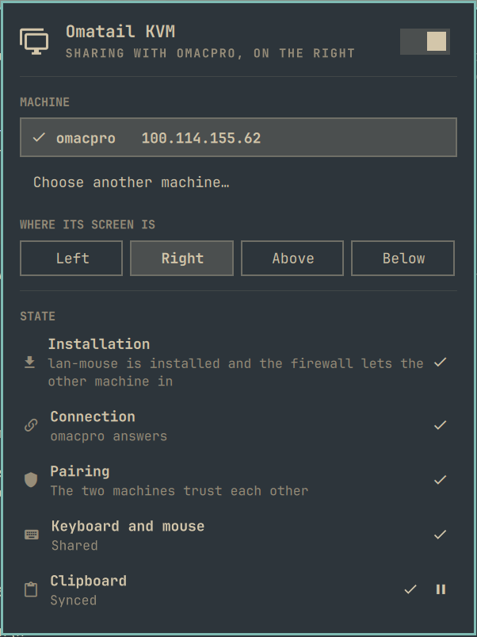
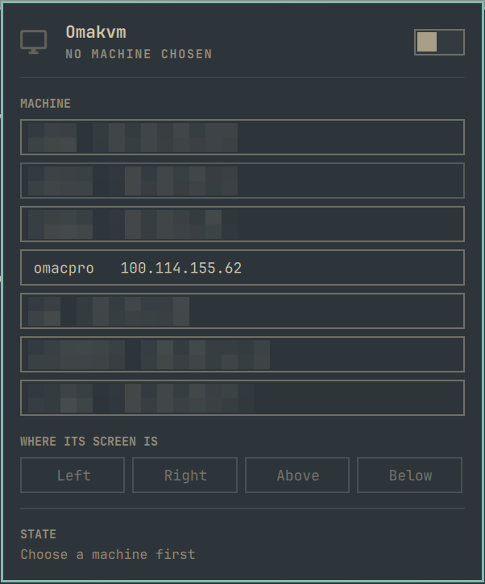
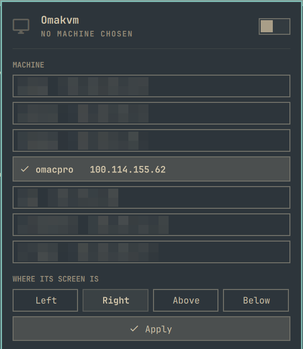

# Omatail KVM



Omatail KVM shares one keyboard, one mouse and one clipboard between two Omarchy
machines. Push the pointer off the edge of one screen and it carries on, with
the keyboard, on the other machine. What you copy on one is ready to paste on
the other. Each machine keeps its own display: Omatail KVM is a software KVM
switch and shares input, not screens.

It is a bar widget that sets everything up: it installs
[Lan Mouse](https://github.com/feschber/lan-mouse) for the keyboard and mouse,
runs a small clipboard relay of its own, opens the firewall to the other
machine only, and pairs the two without anyone copying a fingerprint.

## Requirements

- Omarchy 4 with the Quattro shell plugin system, on both machines.
- [Tailscale](https://tailscale.com), with both machines on the same tailnet.
  Omatail KVM only talks to Tailscale addresses.
- `lan-mouse`, from the official Arch `extra` repository. Omatail KVM installs it;
  nothing comes from the AUR and nothing is compiled.

## Installation

On **each** of the two machines:

```bash
omarchy plugin add https://github.com/Faeric/omatail-kvm.git --enable
```

The plugin is added under `~/.config/omarchy/plugins/io.github.faeric.omatail-kvm`.
It never modifies files under `/usr/share/omarchy`.

## First setup

The whole setup takes about a minute per machine. Do the first machine, then
the second; the order does not matter.

**1. Open the panel and choose the other machine.** Click the Omatail KVM icon in
the bar. The list shows the machines of your tailnet that are online.



**2. Say where its screen is, and press Apply.** Pick the edge of *this*
screen the other screen sits on. On the second machine the edge is already
filled in: it is the opposite of the one chosen on the first.



**3. Type your password in the terminal that opens.** It prints the three
commands it runs as root before asking:

```text
pacman -S --needed --noconfirm lan-mouse
ufw allow in on tailscale0 from <other machine> to any port 4242 proto udp
ufw allow in on tailscale0 from <other machine> to any port 4244 proto tcp
```

If you had chosen a different machine before, it also lists the `ufw delete`
commands that close the firewall to that earlier machine.

On the first machine it says `Waiting for <other machine>: it has not chosen
this machine as its peer yet.` before `Setup is complete.` That is expected:
nothing more is needed there. Close the terminal and go to the second machine.

**4. Do the same on the second machine.** When its terminal ends with
`Setup is complete.`, the two machines have paired on their own and sharing
is on. Every row of the panel is ticked on both:


If a row is not ticked, its line says what is missing; the download icon on
the Installation row opens the password step again.

## Use

- Move the pointer across the chosen edge to reach the other machine. The
  keyboard follows, shortcuts with Super included.
- `Left Ctrl` + `Left Shift` + `Left Super` + `Left Alt` brings the pointer
  back to the local machine at any time.
- Copy on one machine, paste on the other. Text and PNG images are synced, up
  to 32 MiB. Each machine keeps its own clipboard history.
- Bar icon: left click opens the panel, right click starts or stops sharing,
  middle click refreshes.

The same actions are available over IPC:

```bash
omarchy-shell io.github.faeric.omatail-kvm toggle          # open or close the panel
omarchy-shell io.github.faeric.omatail-kvm toggleSharing
omarchy-shell io.github.faeric.omatail-kvm status
```

and from the command line, with
`~/.config/omarchy/plugins/io.github.faeric.omatail-kvm/scripts/omatail-kvm`
(`status`, `configure`, `pair`, `enable`, `disable`, `pause`, `resume`).

## What it changes

Everything outside the plugin's own folder is listed here.

- **As root, once per machine, in the terminal described above:** the
  `lan-mouse` package and two `ufw` rules limited to the other machine's
  address on the Tailscale interface.
- **For your user, in `~/.config/systemd/user`:** `omatail-kvm-lan-mouse.service`,
  `omatail-kvm-clip.socket`, `omatail-kvm-clip@.service` and `omatail-kvm-clip-watch.service`.
  They start with the graphical session.
- **`~/.config/lan-mouse/config.toml`:** written by Omatail KVM. A configuration
  that was already there is kept once as `config.toml.before-omatail-kvm`.
- **`~/.config/omatail-kvm`:** the chosen machine and edge.

Choosing a different machine later withdraws what the earlier one was given:
its Lan Mouse pairing is removed at once, and the panel asks for the password
step again to delete its two firewall rules.

## Limits

- Two machines, on Tailscale. A machine on the same LAN but outside the
  tailnet cannot be chosen.
- The other screen is on the left, right, top or bottom; there is no finer
  placement.
- While the Omarchy menu or the clipboard history is open, the pointer stays
  on that screen. They are full-screen overlays that cover the strip Lan Mouse
  watches at the edge; close them and the pointer crosses again.
- Windows cannot be dragged from one machine to the other, and copied files
  are not transferred.

## Security

- Keyboard and mouse traffic is encrypted by Lan Mouse (DTLS) and accepted
  only from a paired certificate.
- The clipboard relay does not encrypt on its own. It is meant to run inside
  Tailscale, where WireGuard encrypts the connection and vouches for the
  sender's address, and Omatail KVM refuses any other kind of address.
- Only one machine is trusted at a time. When you choose another, the
  earlier machine's certificate stops being accepted for keyboard and mouse
  straight away, and its firewall rules are removed by the password step.
- The clipboard relay sends exactly the copy the clipboard reported, never a
  later one, and nothing leaves once syncing is paused.
- The relay answers only the machine you chose; anything else gets `403`. The
  firewall rules admit that one address as well.
- Copies a password manager marks as secret are never sent.
- Pairing trusts Tailscale: a machine is given this one's Lan Mouse
  fingerprint, and trusted in return, only if you chose it here. Anyone who
  can use that machine's Tailscale address can therefore pair with yours.
- The only privileged commands are the three shown above, plus the removal of
  an earlier machine's two firewall rules, run in a visible
  terminal after you type your password. The address they use is validated
  and passed as an argument, never as shell text.

## Updating

```bash
omarchy plugin update io.github.faeric.omatail-kvm
```

## Removal

Stop sharing and remove the services **before** removing the plugin, or they
are left behind with nothing to manage them:

```bash
~/.config/omarchy/plugins/io.github.faeric.omatail-kvm/scripts/omatail-kvm remove
omarchy plugin remove io.github.faeric.omatail-kvm
```

To undo the rest:

```bash
sudo ufw delete allow in on tailscale0 from <other machine> to any port 4242 proto udp
sudo ufw delete allow in on tailscale0 from <other machine> to any port 4244 proto tcp
sudo pacman -Rns lan-mouse
rm -rf ~/.config/omatail-kvm
```

`omarchy plugin remove` keeps a hidden copy of the plugin next to where it
was, `~/.config/omarchy/plugins/.io.github.faeric.omatail-kvm.bak.<date>`; delete
it if you do not want it.

`~/.config/lan-mouse` holds this machine's Lan Mouse certificate and its
configuration; remove it too if you are done with Lan Mouse, or restore
`config.toml.before-omatail-kvm` if you had a configuration of your own.

## Development

```bash
omarchy plugin validate .
./tests/check.sh
```

`tests/fresh-start` puts a machine back to how it was before Omatail KVM, to
rehearse a first install; it asks for your password and moves the
configuration aside instead of deleting it.

`tests/pair-test` checks, with stand-ins for Lan Mouse, that only the machine
chosen now stays trusted.

`tests/clip-relay-test` exercises the relay with stand-ins for the clipboard
and touches nothing on the machine. `tests/clip-smoke-test` uses the real
clipboard: it saves it, makes a few copies, and puts it back.

The shell loads plugins from `~/.config/omarchy/plugins`, not from a checkout.
Copy the files there, then `omarchy restart shell`: a widget already mounted
in the bar is not rebuilt by the file watcher alone.

## License

Omatail KVM is available under the [MIT License](LICENSE). See
[THIRD_PARTY_NOTICES.md](THIRD_PARTY_NOTICES.md) for the programs it relies on
and the project its panel layout follows.

Omatail KVM is an independent community project. It is not an official Omarchy
plugin and is not endorsed by Omarchy or 37signals.
